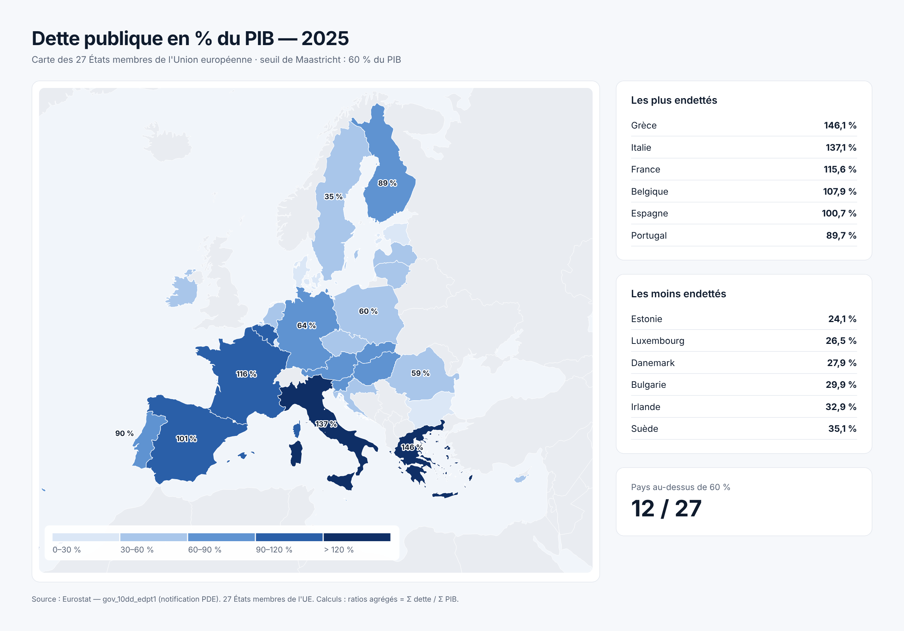
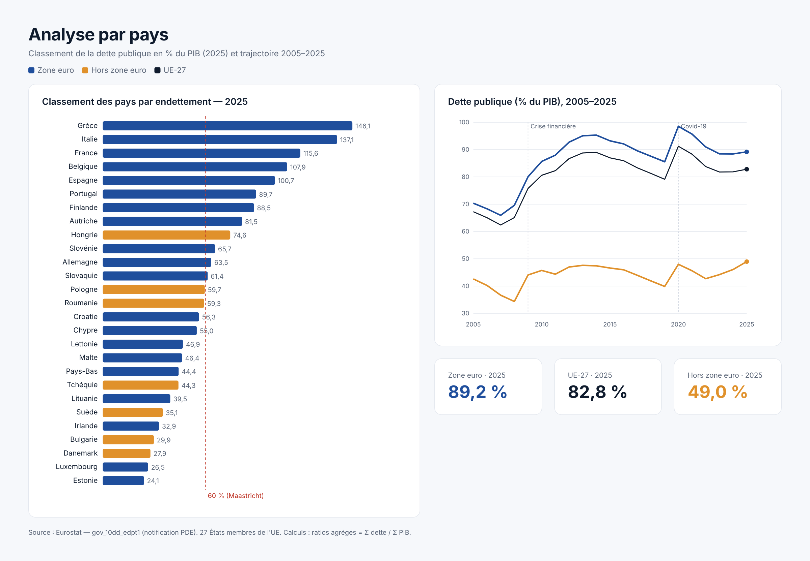
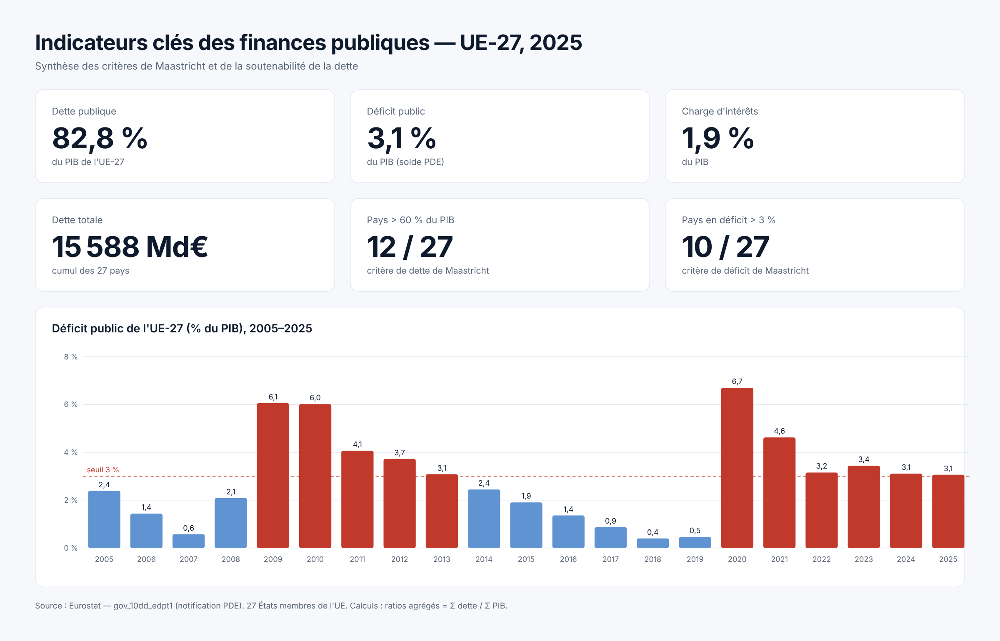

# 🇪🇺 EU-Debt-Insights — Finances publiques européennes 2005–2025


Tableau de bord **Power BI** qui analyse la **dette publique**, le **déficit**, la **charge d'intérêts**, les **recettes** et les **dépenses** des **27 États membres de l'Union européenne** de **2005 à 2025**, au regard des critères de Maastricht (dette ≤ 60 % du PIB, déficit ≤ 3 % du PIB).

> Projet réalisé dans le cadre du Bachelor 3, Nexa Digital School (semestre 1).


---

## 📌 Sommaire

- [Objectifs](#-objectifs)
- [Résultats clés](#-résultats-clés)
- [Interprétation des résultats](#-interprétation-des-résultats)
- [Aperçus](#-aperçus)
- [Données](#-données)
- [Pipeline et modélisation](#-pipeline-et-modélisation)
- [Mesures DAX](#-mesures-dax)
- [Structure du dépôt](#-structure-du-dépôt)
- [Utilisation](#-utilisation)
- [Limites et améliorations](#-limites-et-améliorations)
- [Auteur et licence](#-auteur)

---

## 🎯 Objectifs

1. **Mesurer** l'état des finances publiques de chaque pays : dette, déficit, intérêts, recettes, dépenses (en % du PIB et en milliards d'euros).
2. **Comparer** les pays entre eux et opposer **zone euro** et **hors zone euro**.
3. **Suivre** le respect des critères de Maastricht et l'évolution sur 20 ans (crise de 2008, pandémie de 2020).

## 📊 Résultats clés (2025)

| Indicateur (UE-27) | Valeur |
|---|---|
| Dette publique | **82,8 % du PIB** (soit 15 588 Md€) |
| Déficit public | **3,1 % du PIB** |
| Charge d'intérêts | **1,9 % du PIB** |
| Pays au-dessus de 60 % de dette | **12 / 27** |
| Pays en déficit supérieur à 3 % | **10 / 27** |
| Dette zone euro / hors zone euro | **89,2 % / 49,0 %** |

- Les pays les plus endettés sont la **Grèce (146,1 %)**, l'**Italie (137,1 %)** et la **France (115,6 %)**.
- Les moins endettés sont l'**Estonie (24,1 %)**, le **Luxembourg (26,5 %)** et le **Danemark (27,9 %)**.
- Le ratio d'endettement de l'UE est passé de 67,2 % en 2005 à un pic de 91,2 % en 2020.

*Chiffres calculés à partir des données nettoyées (`data/cleaned/`), en ratios agrégés Σ dette / Σ PIB.*

## 🧠 Interprétation des résultats

### 1. Une dette élevée, installée durablement au-dessus du seuil de Maastricht
Avec **82,8 % du PIB**, la dette de l'UE-27 dépasse de plus de 20 points le seuil de 60 %. Ce n'est pas un phénomène récent : le ratio a franchi 75 % dès 2009 et n'est plus repassé sous 79 % depuis 2010. Chaque crise a fait monter la dette par paliers (**+15,5 points** entre 2008 et 2010, **+12,1 points** en 2020), alors que les phases de reprise ne l'ont réduite que lentement (de 89,0 % en 2014 à 79,1 % en 2019). Les crises font monter la dette vite, les reprises ne la font baisser que lentement.

### 2. Deux chocs majeurs : la crise financière et la pandémie
- **2009–2010 (crise financière puis crise des dettes souveraines)** : le déficit de l'UE atteint **6,1 % du PIB**. Les États soutiennent leurs banques et leur économie, tandis que les recettes fiscales s'effondrent avec la récession.
- **2020 (Covid-19)** : le déficit bondit à **6,7 %** (record de la période) et la dette à **91,2 %**. Chômage partiel, prêts garantis et aides aux entreprises sont financés par l'emprunt, au moment où le PIB recule. Cette baisse du dénominateur amplifie mécaniquement le ratio.
- Depuis 2021, la dette recule légèrement grâce à la reprise et à l'inflation, qui gonfle le PIB nominal. Le déficit reste toutefois proche de **3 %** (3,1 % en 2025).

### 3. Une Europe à deux vitesses : zone euro contre hors zone euro
La zone euro est endettée à **89,2 %**, les pays hors zone euro à **49,0 %**, soit un écart de 40 points. Plusieurs facteurs l'expliquent :
- les plus grandes économies endettées (France, Italie, Espagne, Belgique, Grèce) appartiennent toutes à la zone euro ;
- la monnaie unique et l'action de la BCE ont longtemps maintenu des taux d'emprunt bas, ce qui a rendu l'endettement plus supportable ;
- les pays d'Europe centrale et nordique hors zone euro (Danemark, Suède, Tchéquie, Bulgarie) partent de niveaux de dette historiquement faibles.

L'écart se réduit pourtant : la dette hors zone euro est passée de 39,9 % en 2019 à 49,0 % en 2025, portée par la **Roumanie (+24 points)** et la **Pologne (+14,5 points)**.

### 4. Une dette concentrée sur quelques grands pays
**France (22,2 %)**, **Italie (19,9 %)**, **Allemagne (18,2 %)** et **Espagne (10,9 %)** portent à elles seules **71 % de la dette européenne** en euros. Le ratio en % du PIB et le montant en milliards ne racontent donc pas la même histoire : la Grèce a le ratio le plus élevé (146 %) mais ne pèse que 2,3 % de la dette totale, alors que l'Allemagne, sous les 64 %, en représente près d'un cinquième. La soutenabilité de la dette européenne dépend surtout de la trajectoire de ces quatre pays.

### 5. Des trajectoires nationales contrastées
- **Les pays en redressement** : la **Grèce** (de 209,4 % en 2020 à 146,1 %), **Chypre** (de 113,6 % à 55,0 %), le **Portugal** (de 134,1 % à 89,7 %) et l'**Irlande** (de 118,9 % en 2012 à 32,9 %) ont fortement réduit leur dette. Ils sont aussi, avec le Danemark, les **5 pays en excédent budgétaire en 2025**. Pour la Grèce et le Portugal, l'ajustement fait suite aux programmes d'aide de 2010–2018. Pour l'Irlande, il s'explique par une croissance très forte du PIB.
- **Les pays qui s'enfoncent** : la **France** (+47 points depuis 2005, +17 points depuis 2019) atteint en 2025 son plus haut niveau de la période, avec un déficit de 5,1 %. La **Finlande**, la **Roumanie**, la **Pologne**, la **Slovaquie** et la **Tchéquie** atteignent elles aussi leur maximum en 2025.
- **Les « bons élèves » historiques** : l'**Estonie** (24,1 %), le **Luxembourg**, le **Danemark** et la **Suède** restent très en dessous de 60 %, ce qui leur donne d'importantes marges de manœuvre budgétaires.

### 6. Le non-respect simultané des deux critères
**7 pays** cumulent en 2025 une dette supérieure à 60 % **et** un déficit supérieur à 3 % : **France, Italie, Belgique, Autriche, Finlande, Hongrie et Slovaquie**. Ce sont les situations les plus fragiles, car la dette y continue de croître alors qu'elle est déjà élevée. La France et la Belgique affichent à la fois une dette supérieure à 100 % et un déficit supérieur à 5 %.

### 7. Le retour de la charge d'intérêts
La charge d'intérêts de l'UE est passée de **2,8 % du PIB en 2005** à un plancher de **1,35 % en 2021**, grâce à des taux historiquement bas, malgré une dette plus élevée. Avec la remontée des taux depuis 2022, elle remonte à **1,9 %** en 2025. L'**Italie (3,9 %)**, la **Hongrie (3,8 %)** et la **Grèce (3,2 %)** consacrent la plus grande part de leur richesse au service de la dette. Au fil du refinancement, les anciens emprunts à taux bas sont remplacés par des emprunts plus chers. Cette charge devrait donc continuer d'augmenter et réduire les marges budgétaires des pays les plus endettés.

### En résumé
L'UE sort de deux décennies de crises avec une dette durablement supérieure à 80 % du PIB, très concentrée sur quelques grandes économies de la zone euro. Plusieurs pays du Sud, longtemps considérés comme les plus fragiles (Grèce, Portugal, Chypre, Irlande), se sont redressés. La vigilance porte désormais sur des pays comme la **France**, la **Belgique**, la **Finlande** et la **Roumanie**, où dette et déficit progressent encore alors que le coût de l'emprunt augmente.

## 🖼️ Aperçus

| Carte de l'endettement | Analyse par pays |
|---|---|
|  |  |



> `home_page.png` est une capture du rapport Power BI. Les visuels `debt_map.png`, `country_analysis.png` et `kpi_page.png` sont générés à partir des données nettoyées du modèle et complètent le tableau de bord.

## 🗂️ Données

| Source | Jeu Eurostat | Contenu |
|---|---|---|
| `gov_10dd_edpt1.csv` | [gov_10dd_edpt1](https://ec.europa.eu/eurostat/databrowser/view/gov_10dd_edpt1/default/table) | Déficit, dette publique et intérêts (notification PDE) |
| `gov_10a_main.csv` | [gov_10a_main](https://ec.europa.eu/eurostat/databrowser/view/gov_10a_main/default/table) | Recettes et dépenses des administrations publiques |
| `lib_geo.csv` | — | Correspondance code pays → nom en français |

- **Périmètre** : 27 États membres, 2005–2025, fréquence annuelle.
- **Exclusions** : agrégats européens (EA19, EA20, EA21, EU27_2020), Islande, Norvège et Suisse.
- **Licence des données** : © Union européenne, Eurostat — réutilisation autorisée sous [CC BY 4.0](https://ec.europa.eu/eurostat/about-us/policies/copyright).

Les fichiers bruts sont décrits dans [`data/raw/README.md`](data/raw/README.md) et les tables nettoyées (export du modèle) sont dans [`data/cleaned/`](data/cleaned/).

## ⚙️ Pipeline et modélisation

```
CSV Eurostat ──► Power Query ──► Modèle en étoile ──► Mesures DAX ──► Rapport Power BI
(format large)   séparation,      pays (dimension)     ratios, rangs,   KPI, classements,
                 dépivotage,      dette_deficit        parts, critères  segment Année
                 nettoyage,       recettes_depenses    de Maastricht
                 pivot
```

**Power Query**
- Séparation de la colonne d'identifiants Eurostat (`freq, unit, sector, na_item, geo`).
- Dépivotage des colonnes années, puis nettoyage des drapeaux qualité Eurostat (`:`, `p`, `e`, `b`, `m`).
- Conversion numérique (paramètres régionaux en-US) et pivot des indicateurs en colonnes.
- Construction de la dimension `pays` (fusion avec `lib_geo`, ajout de l'appartenance à la zone euro).

**Modèle de données**

```
 dette_deficit  ──*:1──►  pays  ◄──1:*──  recettes_depenses
                      (geo\TIME_PERIOD)
 Annee  : GENERATESERIES(2005, 2025, 1) → segment Année
 MESURES: table conteneur des 28 mesures DAX
```

## 🧮 Mesures DAX

28 mesures, dont les principales :

```DAX
Dette % PIB =
DIVIDE ( SUM ( dette_deficit[dette_meur] ), SUM ( dette_deficit[pib_meur] ) ) * 100

Part de la dette =
DIVIDE ( [Dette Md€], CALCULATE ( [Dette Md€], REMOVEFILTERS ( pays ) ) )

Rang dette =
RANKX ( ALL ( pays ), [Dette % PIB], , DESC )

Nb pays dette > 60 % =
CALCULATE ( DISTINCTCOUNT ( dette_deficit[geo\TIME_PERIOD] ), dette_deficit[dette_pib] > 60 )

Dette zone euro =
VAR ZonePays = SELECTEDVALUE ( pays[zone] )
RETURN
    IF ( ISBLANK ( ZonePays ) || ZonePays = "Zone euro",
         CALCULATE ( [Dette % PIB], REMOVEFILTERS ( pays ), pays[zone] = "Zone euro" ) )
```

La liste complète (expressions et descriptions) est dans le [dictionnaire de données](docs/data_dictionary.pdf).

## 📁 Structure du dépôt

```
EU-Debt-Insights/
│
├── dashboard/
│   └── EU_Debt_Analysis.pbix        # Rapport Power BI
│
├── data/
│   ├── raw/                          # CSV Eurostat bruts (voir README)
│   └── cleaned/                      # Tables nettoyées exportées du modèle
│       ├── dette_deficit.csv
│       ├── recettes_depenses.csv
│       └── pays.csv
│
├── images/
│   ├── home_page.png
│   ├── debt_map.png
│   ├── country_analysis.png
│   └── kpi_page.png
│
├── docs/
│   ├── data_dictionary.pdf           # Tables, colonnes, mesures DAX, transformations
│   └── project_presentation.pdf      # Présentation du projet (12 slides)
│
├── README.md
└── LICENSE
```

## 🚀 Utilisation

1. Cloner le dépôt :
   ```bash
   git clone https://github.com/<votre-utilisateur>/EU-Debt-Insights.git
   ```
2. Ouvrir `dashboard/EU_Debt_Analysis.pbix` avec **Power BI Desktop** (gratuit, Windows).
3. Le rapport s'ouvre avec les données déjà importées. Pour **actualiser** :
   - placer les CSV Eurostat dans `data/raw/` (voir [instructions](data/raw/README.md)) ;
   - dans Power BI : *Transformer les données → Paramètres de la source de données → Changer la source* et pointer vers `data/raw/` ;
   - cliquer sur **Actualiser**.

Les tables de `data/cleaned/` peuvent aussi être utilisées directement dans Excel, Python ou un autre outil BI.

## 🔍 Limites et améliorations

- **Recettes / dépenses** : la requête `recettes_depenses` ne filtre pas le secteur institutionnel ; le pivot additionne S13 et ses sous-secteurs, ce qui surévalue les recettes, les dépenses et la mesure `Déficit % PIB`. Correctif prévu : filtrer `sector = "S13"` avant le pivot. Le déficit présenté dans ce README provient du solde PDE (`solde_meur`), qui n'est pas concerné.
- **Segment Année** : la table `Annee` n'est pas encore reliée aux tables de faits ; il faut créer les relations `Annee[Value] → dette_deficit[annee]` et `→ recettes_depenses[annee]` pour que le filtre par année s'applique.
- **Mesure `Dette France`** : le filtre doit porter sur `"France"` (ou sur le code `"FR"` de `geo\TIME_PERIOD`).
- **Pistes** : connexion directe à l'API Eurostat, carte interactive, pages pays détaillées, ajout de la croissance et de l'inflation pour analyser la dynamique de la dette.

## 👤 Auteur

**Awovi Fangnon** · Bachelor 3, Nexa Digital School

## 📄 Licence

Code, modèle et documentation sous licence [MIT](LICENSE). Données © Union européenne, Eurostat, sous licence CC BY 4.0.
